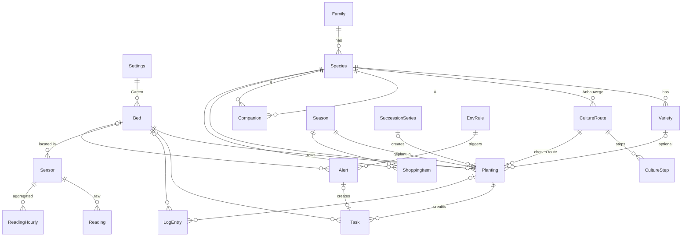

# Gardenplaner – Phase 0: Specification

Status: draft v2 · 03.11.2026 (v2: clean start, environment data §8)
Scope: data model, rules engine, starting plant data, screens. No code yet.

---

## 0. Decisions so far

| Topic | Decision |
|---|---|
| Users | Single user, simple password login (so it can go online later) |
| Devices | Desktop = planning · phone = "Gartenmodus" (tasks, ticking off, harvest log, quick edits), PWA |
| UI language | **German only.** Code and DB stay in English. All UI text in one file (`de.ts`). Dates `dd.MM.yyyy`, weeks shown as "KW 45", starting Monday |
| Placement | **Rows**: a planting is one row in a bed (count or full row) |
| Row direction | Same within a bed; set per bed (horizontal or vertical on the 2D map) |
| Pre-culture | Locations: **Fensterbank**, **Gewächshaus** |
| Greenhouse | Is also a **bed** (tomato, cucumber, pepper, chilli), rotation mode "warning only" |
| Varieties | Optional; plan by species, add a variety when you give one |
| Fertilizing | Generic, by feeding type |
| Extras | Bed history, succession growing, shopping list (no stock), green manure, storage tips |
| Plant card | One side, long format, all German |
| History | Season 2026 is entered as history (you place the plants yourself later) |
| Stack | TypeScript end to end: SvelteKit + Drizzle ORM + **Postgres**, Docker (see §8) |
| Environment data | Weather (Open-Meteo) + sensors (air/soil temperature, humidity, light) planned now, built in P7 |

---

## 1. Glossary (UI ↔ code)

| UI (DE) | Code | Meaning |
|---|---|---|
| Pflanzenart | `Species` | e.g. Tomate |
| Sorte | `Variety` | e.g. 'Linda' (optional) |
| Pflanzenfamilie | `Family` | Basis for rotation |
| Nährstoffbedarf | `feedingType` | Starkzehrer / Mittelzehrer / Schwachzehrer |
| Anbauweg | `CultureRoute` | e.g. "Vorkultur Fensterbank" or "Direktsaat" |
| Arbeitsschritt | `CultureStep` | Rule that produces tasks |
| Beet | `Bed` | Includes the greenhouse |
| Pflanzung / Reihe | `Planting` | One row of one crop over a date range |
| Satzfolge | `SuccessionSeries` | Repeated sowing (e.g. lettuce every 3 weeks) |
| Saison | `Season` | Garden year |
| Aufgabe | `Task` | Calendar entry |
| Tagebuch | `LogEntry` | Harvest, note, problem, soil test, photo |
| Einkaufsliste | `ShoppingItem` | What to buy, generated from the plan |
| Gründüngung | `Species.isGreenManure` | Phacelia, Gelbsenf |

---

## 2. Entity diagram



---

## 3. Entities

### Settings (one row)
`gardenName`, `lat`, `lon` (Braunschweig area), `lastFrost` (MM-DD, default **05-15**, after the Eisheiligen), `firstFrost` (default **10-15**), `greenhouseLeadDays` (default 21: greenhouse planting-out is this many days before last frost), `passwordHash`.

### Family
`id`, `nameDe`, `nameLat`, `rotationPauseYears` (default 3; Rosengewächse 4).

### Species
| Field | Type | Note |
|---|---|---|
| `slug`, `nameDe`, `nameLat` | text | |
| `familyId` | FK | |
| `feedingType` | enum `HEAVY \| MEDIUM \| LIGHT \| NONE` | NONE = green manure |
| `lifecycle` | enum `ANNUAL \| PERENNIAL` | |
| `lifespanYears` | int? | perennials: how many years they stay in the bed |
| `heightCm`, `widthCm` | int range | for the plant card + tall plants on the north side |
| `rowSpacingCm` | int | = width of a row in the bed |
| `inRowSpacingCm` | int | → number of plants per row |
| `toxicityLevel` | enum `NONE \| CAUTION \| TOXIC` | |
| `toxicityDe` | text? | |
| `careDe`, `storageDe` | text | |
| `fertilizeIntervalDays` | int? | overrides the feeding-type default |
| `defaultSourcing` | enum `SEED \| SEEDLING \| SETS \| EXISTING` | SETS = onion sets / seed potatoes |
| `setWeightG` | int? | seed potato ≈ 60 g → kg for the shopping list |
| `outdoor`, `greenhouse` | bool | where it can grow |
| `isGreenManure` | bool | |
| `imageUrl`, `imageCredit`, `imageLicense` | text | Wikimedia Commons |

### Variety (optional)
`speciesId`, `nameDe`, `daysToMaturity?`, `notesDe`, `overrides` (JSON: spacing, timing).

### CultureRoute / CultureStep
A species has 1..n **routes** (Gurke: "Vorkultur Fensterbank" | "Direktsaat"). Each route is an ordered list of **steps**:

| Field | Type |
|---|---|
| `type` | `PRESOW \| PRICK_OUT \| PRESPROUT \| HARDEN_OFF \| DIRECT_SOW \| PLANT_OUT \| CARE \| FERTILIZE \| PRUNE \| HARVEST \| CLEAR` |
| `location` | `WINDOWSILL \| GREENHOUSE \| BED` |
| `anchor` | `LAST_FROST \| FIRST_FROST \| PLANTING_START \| PREV_STEP \| FIXED_MMDD` |
| `offsetStartDays`, `offsetEndDays` | int (time window relative to the anchor) |
| `repeatEveryDays` | int? (e.g. pinching out side shoots weekly) |
| `labelDe` | text ("Tomaten pikieren") |
| `isPlantingStart` / `isPlantingEnd` | bool – marks when the row in the bed becomes taken and free again |

### Companion
`speciesAId < speciesBId`, `relation GOOD | BAD`, `reasonDe`.

### Bed
`name`, `type FLAT | RAISED | GREENHOUSE | POTS`, `xCm`, `yCm`, `lengthCm`, `widthCm`, `rowDirection HORIZONTAL | VERTICAL`, `rotationMode STRICT | WARN | OFF`, `sun FULL | PARTIAL | SHADE`, `soilDe`, `active`.
Rows always run **along `lengthCm`**; they are stacked across `widthCm`.

### Season
`year`, `status HISTORY | PLANNING | ACTIVE | ARCHIVED`. 2026 = HISTORY.

### Planting (= one row of one crop)
| Field | Note |
|---|---|
| `seasonId`, `bedId`, `speciesId`, `varietyId?`, `routeId` | |
| `offsetCm` | position across the bed (from the top/left edge) |
| `widthCm` | default = `rowSpacingCm` |
| `quantityMode` | `FULL_ROW \| COUNT` |
| `count?` | for COUNT; row length = count × `inRowSpacingCm` |
| `startDate`, `endDate` | time the row is taken in the bed (calculated from the route, can be moved by hand) |
| `endSeasonYear?` | perennials: last year it stays |
| `sourcing` | from the species, can be changed |
| `status` | `PLANNED \| ACTIVE \| DONE` |
| `successionSeriesId?` | |
| `notesDe` | |

### SuccessionSeries
`speciesId`, `bedId`, `offsetCm`, `firstDate`, `intervalDays`, `count` → creates n plantings (in the same row one after another, or in neighbouring rows).

### Task
`plantingId?`, `bedId?`, `type`, `location`, `titleDe`, `dueStart`, `dueEnd`, `status OPEN | DONE | SKIPPED`, `doneAt?`, `generatedKey?` (unique; null = manual), `notesDe`.

### LogEntry
`date`, `plantingId?`, `bedId?`, `type HARVEST | NOTE | PROBLEM | SOIL_TEST | PHOTO`, `amount?`, `unit? (kg | Stück | Bund)`, `textDe`, `photoPath?`, `ph?`.

### ShoppingItem
`seasonId`, `speciesId`, `varietyId?`, `kind SEED | SEEDLING | SETS | GREEN_MANURE`, `quantity`, `unit`, `bought bool`, `generated bool`.

---

## 4. Rules engine (package `@garden/rules`, runs in the browser and on the server)

**Overlap:** two plantings overlap ⇔ same bed ∧ the ranges `[offset, offset+width]` intersect ∧ the date ranges intersect.

### 4.1 Space check
- `offsetCm + widthCm ≤ bed.widthCm`
- no overlap with another planting
- COUNT: `count × inRowSpacing ≤ bed.lengthCm`
- FULL_ROW: `count = floor(lengthCm / inRowSpacingCm)`

### 4.2 Crop rotation
For a new planting P in bed B, take every planting H with the same position across the bed and an `endDate` within the last `family.rotationPauseYears` years:
- `H.family == P.family` → **STRICT: blocked · WARN: warning + task "Erde tauschen / Kompost" · OFF: no check**
- Score for feeding order (heavy → medium → light → green manure → heavy): previous main crop is the expected predecessor = +2, same feeding type again = −1.
- Perennials (Erdbeere, Himbeere) stay in place for every year they span → they block the space and are not rotated.

### 4.3 Neighbours
Rows **directly next to each other** in the same bed (gap between row edges ≤ 10 cm) that overlap in time:
`GOOD` +1 · `BAD` −3 + warning. Shown live while dragging.

### 4.4 Task generation
- Each `CultureStep` of a planting's route → task with a window `[anchor+offsetStart, anchor+offsetEnd]`.
- `anchor` = Settings frost dates, the planting's start date, or the previous step. In the greenhouse, LAST_FROST is moved earlier by `greenhouseLeadDays`.
- Repeating steps (`repeatEveryDays`) → one task per interval between plant-out and harvest end.
- Fertilizing by feeding type: Starkzehrer every 14 days · Mittelzehrer every 28 days · Schwachzehrer once at planting · Gründüngung none.
- **Idempotent:** `generatedKey = plantingId:stepId:n`. When dates are recalculated, open tasks move with the planting; DONE/SKIPPED stay unchanged.
- Week view = tasks whose window touches the week, grouped by location (Fensterbank / Gewächshaus / Beet X).

### 4.5 Green manure
When a planting is set to DONE (or the planner finds a free space) and the gap until the next planting is ≥ 6 weeks:
- Suggest a green manure that fits the season (Phacelia Apr–Sep, Gelbsenf Aug–Sep).
- **Exclude cross-family conflicts:** no Gelbsenf if a Kreuzblütler (cabbage, Radieschen) is coming next or grew there recently.
- Green manure is a normal planting → it counts for rotation and the bed history.

### 4.6 Succession growing
A series creates n plantings with `firstDate + i × intervalDays`. Moving or deleting one asks: "nur diesen Satz / alle folgenden".

### 4.7 Shopping list (no stock)
Generated per season from all PLANNED plantings, grouped by `kind`:
- SEED: species/variety + metres of row or number of plants (e.g. "Möhre – 2 Reihen à 2,0 m")
- SEEDLING: number of plants
- SETS: seed potatoes in kg (`count × setWeightG`), onion sets as a number
- GREEN_MANURE: m² of bed
Entries can be ticked "gekauft"; regenerating keeps manual entries and ticks.

### 4.8 Suggestion engine (Phase 5)
Input: wishlist (species, count or number of rows). Fill the highest-value spots first (score = rotation + neighbours + sun + tall plants on the north side), then improve by swapping (local search). Output = suggested plantings with status PLANNED, which you confirm.

---

## 5. Starting plant data (to be checked in P1)

LF = last frost (15.05), FF = first frost (15.10). Spacing in cm (between rows × in the row).

| Art | Latein | Familie | Bedarf | Abstand | Anbauweg(e) | Ernte | Giftig | Lagerung |
|---|---|---|---|---|---|---|---|---|
| Tomate | *Solanum lycopersicum* | Nachtschatten | Stark | 80×50 | Fensterbank LF−10…−8 W → pricking out → hardening off → Beet/GH from LF (GH LF−3 W) | Jul–Okt | Grüne Teile, unreife Früchte (Solanin) | 12–16 °C, nicht in den Kühlschrank, grüne nachreifen lassen |
| Gurke | *Cucumis sativus* | Kürbisgewächse | Stark | 100×50 | a) Fensterbank LF−4 W → planting out LF+1 W · b) direct sowing LF…LF+3 W | Jul–Sep | – | 10–13 °C, getrennt von Tomaten/Äpfeln (Ethylen) |
| Salat | *Lactuca sativa* | Korbblütler | Schwach | 30×30 | Direct sowing Mär–Aug, succession every 3 W; optionally Fensterbank from Feb | 6–10 W after sowing | – | feucht im Kühlschrank, 3–5 Tage |
| Radieschen | *Raphanus sativus* var. *sativus* | Kreuzblütler | Schwach | 15×5 | Direct sowing Mär–Mai + Aug–Sep, succession every 2–3 W | 4–6 W after sowing | – | Blätter ab, Kühlschrank ~1 Woche |
| Zwiebel | *Allium cepa* | Lauchgewächse | Schwach | 25×10 | Onion sets Mär–Apr | Aug (when the leaves fall over) | Giftig für Hunde/Katzen | 2–3 W trocknen, dann dunkel, kühl, trocken (Monate) |
| Möhre | *Daucus carota* subsp. *sativus* | Doldenblütler | Mittel | 25×4 | Direct sowing Mär–Jun | 10–16 W after sowing | – | Grün ab, in feuchtem Sand kühl (Monate) |
| Kartoffel | *Solanum tuberosum* | Nachtschatten | Stark | 70×35 | Pre-sprouting Fensterbank (bright, cool) LF−10…−6 W → planting Apr → hilling | Früh: Jun–Jul · Spät: Aug–Sep | Grüne Teile, grüne Knollen, Beeren (Solanin) | dunkel, 4–8 °C, frostfrei |
| Erdbeere | *Fragaria × ananassa* | Rosengewächse | Mittel | 70×30 | Plant Jul–Aug, stays 3–4 years; remove runners, put straw under the plants | Jun–Jul (everbearing until Okt) | – | kaum lagerbar, 1–2 Tage kühl, einfrieren |
| Himbeere (Herbst) | *Rubus idaeus* | Rosengewächse | Mittel | 180×50 | Plant Okt–Nov or Mär, permanent crop ~10 years, root barrier; cut back to ground in Feb | Aug–Okt | – | sofort verbrauchen oder einfrieren |
| Paprika | *Capsicum annuum* | Nachtschatten | Stark | 50×40 | Fensterbank (warm) LF−12…−10 W → GH | Jul–Okt | Grüne Teile leicht giftig | 8–10 °C, ~1 Woche |
| Chili | *Capsicum* spp. | Nachtschatten | Stark | 50×40 | Fensterbank LF−16…−12 W → GH | Aug–Okt | Capsaicin: Handschuhe | trocknen, einlegen, einfrieren |
| Phacelia | *Phacelia tanacetifolia* | Raublattgewächse | – | broadcast | Direct sowing Apr–Sep | dig in / leave frozen over winter | – | – |
| Gelbsenf | *Sinapis alba* | Kreuzblütler | – | broadcast | Direct sowing Aug–Sep | dig in before seeding | – | – |

### Neighbours (starting matrix)
| | gut | schlecht |
|---|---|---|
| Tomate | Möhre, Salat, Zwiebel, Radieschen, Paprika | Kartoffel, Gurke |
| Gurke | Zwiebel, Salat | Tomate, Kartoffel, Radieschen |
| Salat | Radieschen, Möhre, Zwiebel, Erdbeere, Tomate, Gurke | – |
| Radieschen | Salat, Möhre, Tomate | Gurke |
| Zwiebel | Möhre, Erdbeere, Tomate, Gurke, Salat | – |
| Möhre | Zwiebel, Salat, Tomate, Radieschen | – |
| Kartoffel | – | Tomate, Gurke, Himbeere |
| Erdbeere | Zwiebel, Salat | – |
| Himbeere | – | Kartoffel |
| Paprika / Chili | Tomate, Zwiebel | – |

> **Greenhouse note:** tomato and cucumber are "bad neighbours" (they want different humidity). In the greenhouse: put them on opposite sides, not in neighbouring rows → the neighbour rule handles this automatically.

---

## 6. Screens (see wireframes)

| # | Screen | Device | Contents |
|---|---|---|---|
| 1 | **Übersicht** | Desktop | KW tasks by location, ready to harvest, frost warning, season status |
| 1m | **Gartenmodus** | Phone | This week's tasks as a checklist, "Ernte eintragen", "Notiz/Foto" |
| 2 | **Gartenplan** | Desktop (phone: view only) | 2D map, season selector + date slider, rows coloured by crop; click a bed → bed detail with history |
| 3 | **Saisonplanung** | Desktop | Wishlist (left) · bed map with drag & drop (middle) · warnings/suggestions (right) · tab "Einkaufsliste" |
| 4 | **Kalender** | Desktop + phone | KW view (default) / month, filter by location/bed/task type |
| 5 | **Pflanzen** | Both | Library as a grid of cards, search, filter by family/feeding type; card detail |
| 6 | **Tagebuch** | Both | Harvests, notes, problems, soil tests; filter by bed/crop; yield per season |

### Plant card (one side, top → bottom)
1. Picture (credit line + licence) 2. Deutscher Name · *lateinischer Name* · Familie · ein-/mehrjährig 3. Key figures: Höhe, Breite, Abstand, Nährstoffbedarf 4. Toxicity bar (only when relevant) 5. **12-month timeline**: Fensterbank (blue), Gewächshaus (violet), Direktsaat (green), Auspflanzen (orange), Ernte (red) 6. Gute/schlechte Nachbarn (chips) 7. Düngung 8. Lagerung 9. "In deinem Garten 2027: Beet B, Reihe 2".

---

## 7. Phases (unchanged)
P0 spec + wireframes → P1 plant database + cards → P2 beds/rows/seasons/history → P3 tasks + calendar → P4 rotation/neighbours/succession/green manure → P5 suggestions + shopping list → P6 PWA/offline, login, hosting → **P7 weather + sensors** (weather can come earlier, right after P3, since it needs no hardware).

---

## 8. Environment data (planned now, built in P7)

The old prototype was removed on 03.11.2026; we start clean. Weather and sensors are **planned into the model now** so nothing has to be rebuilt later.

### 8.1 Architecture
```
Open-Meteo API ──(scheduler, every 3 h)──┐
Sensors (ESP32 …) ──HTTPS POST + token──►├─ app (SvelteKit) ─ Postgres
                                          │   ├─ ingest  /api/ingest/readings
                                          │   ├─ jobs    weather · aggregation · alerts · task regeneration
                                          │   └─ rules   + environment rules
```
- **Weather:** Open-Meteo (free, no API key, forecast + history, uses DWD models). Stores the forecast for 7 days and daily values.
- **Sensors:** a simple HTTPS endpoint with a token per device. An MQTT or LoRaWAN webhook (TTN) can be added as a second way in later, depending on the hardware (§9).
- **DB:** **Postgres** (instead of SQLite): handles the time series, and runs as a managed service or as a container when hosted online. Plain tables + indexes are enough for this amount of data; TimescaleDB is optional.
- **Jobs** run in the app (node-cron); no separate service needed.

### 8.2 Additional entities
| Entity | Fields |
|---|---|
| **Sensor** | `nameDe`, `kind AIR_TEMP \| AIR_HUMIDITY \| SOIL_MOISTURE \| SOIL_TEMP \| LIGHT_LUX`, `unit`, `bedId?` (also the greenhouse) or `location OUTDOOR`, `deviceId`, `tokenHash`, `active`, `lastSeenAt` |
| **Reading** | `sensorId`, `ts`, `value` – raw values, kept **90 days** |
| **ReadingHourly** | `sensorId`, `hour`, `min`, `max`, `avg` – kept permanently (light: + `luxHours`) |
| **WeatherForecast** | `fetchedAt`, `ts`, `tempC`, `precipMm`, `sunshineMin`, `windKmh`, `soilTempC?` |
| **WeatherDaily** | `date`, `tMinC`, `tMaxC`, `precipMm`, `sunshineH`, `source FORECAST \| OBSERVED` |
| **EnvRule** | `type FROST \| GH_HEAT \| DRY_SOIL \| LOW_LIGHT \| SENSOR_OFFLINE`, `scope (garden/bed)`, `threshold`, `active` |
| **Alert** | `envRuleId`, `bedId?`, `triggeredAt`, `messageDe`, `resolvedAt?`, `taskId?` |

**New species fields (filled in P1 if known):** `minTempC` (frost/cold tolerance), `minSoilTempSowC` (soil temperature needed for germination), `soilMoisture LOW|MEDIUM|HIGH`, `light FULL|PARTIAL|SHADE`, `ghMaxTempC`.

### 8.3 What the data is used for
- **Frost warning:** forecasted minimum < 2 °C in the next 48 h and plantings with `minTempC` above that are in the bed → alert + task "Vlies auflegen / Gewächshaus schließen".
- **Greenhouse heat:** greenhouse air temperature > `ghMaxTempC` → "Lüften".
- **Watering note:** soil moisture below the range for the crop, or < 5 mm rain in 7 days → task "Gießen" for the affected bed.
- **Sowing time:** direct sowing is only suggested when the soil temperature (sensor or Open-Meteo) has stayed ≥ `minSoilTempSowC` for 3 days → the task window can move earlier or later ("Möhren säen: Boden jetzt warm genug").
- **Light:** sum of light hours per bed → check "sun / partial shade" against reality.
- **Logbook/statistics:** weather and sensor values linked to harvest amounts per season.
- **Sensor offline:** no value for > 6 h → note on the dashboard.

### 8.4 Screens
- Overview: weather strip (7 days) + current sensor values per location, active alerts.
- Bed detail: sensor curves (24 h / 7 days / season).
- Settings: manage sensors (create, show token, assign to a bed), alert thresholds.

---

## 9. Open points
1. Sensors: is "humidity" air humidity, soil moisture or both? Where will the sensors go (greenhouse, beds, outside)?
2. Power and network in the allotment (Wi-Fi, LTE, LoRaWAN, battery/solar?) → decides how data gets in (§8.1)
3. Check the timing values and neighbour matrix in §5 (P1)
4. Bed list for the garden: names, sizes, positions, row direction → P2
